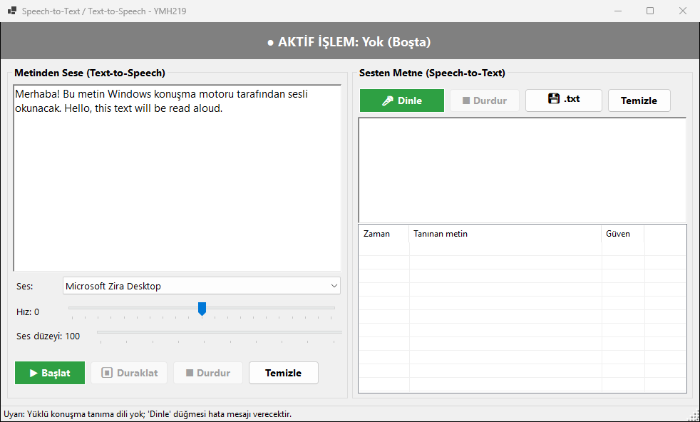
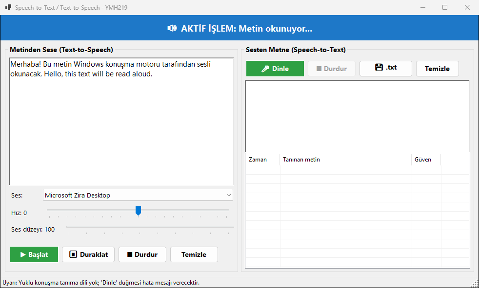
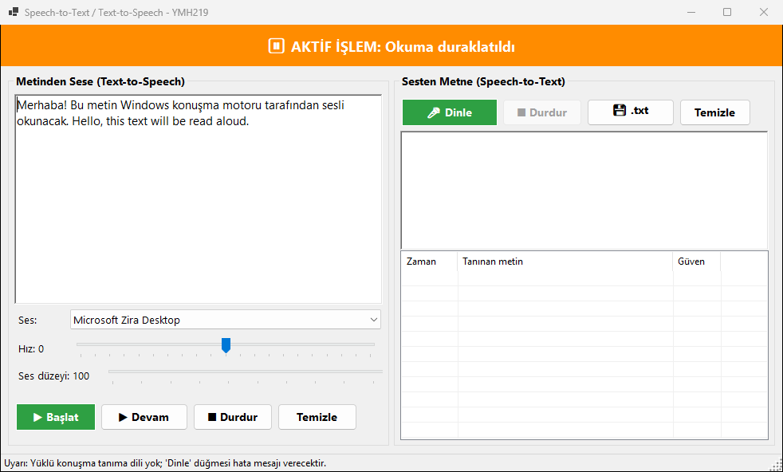
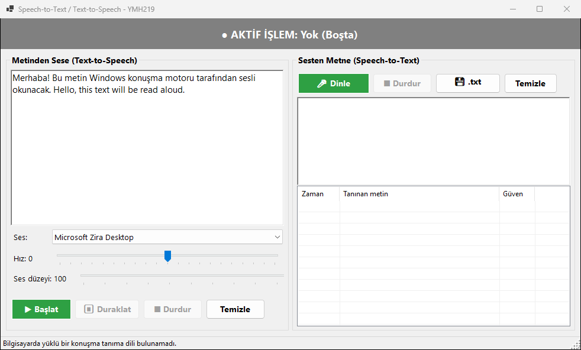

# YMH219-SpeechApp

Windows Forms (C# / .NET) ile geliştirilmiş **Text-to-Speech** ve **Speech-to-Text** uygulaması. Yazılan metni sesli okutur, mikrofondan alınan konuşmayı metne çevirir. Nesne Tabanlı Programlama (YMH 219) dersi ek uygulama ödevidir.

## Kullanılan Teknolojiler
- C# 14 / .NET 10, Windows Forms
- NuGet: [`System.Speech`](https://www.nuget.org/packages/System.Speech) 10.0.0 (`SpeechSynthesizer`, `SpeechRecognitionEngine`, `DictationGrammar`)

## Kurulum ve Çalıştırma
1. Windows ve [.NET 10 SDK](https://dotnet.microsoft.com/download) gerekir.
2. `git clone https://github.com/MetehanSalihoglu/YMH219-SpeechApp.git` ve `cd YMH219-SpeechApp`
3. `dotnet run --project SpeechApp` (veya `.sln` dosyasını Visual Studio ile açıp F5; NuGet paketi otomatik geri yüklenir)
4. Konuşma tanıma için Windows'ta bir **konuşma tanıma dili** yüklü ve mikrofon erişimi açık olmalıdır (Ayarlar > Zaman ve Dil > Konuşma; Gizlilik > Mikrofon).

## Temel Özellikler
- **Text-to-Speech:** TextBox/RichTextBox içindeki metin **Başlat**, **Duraklat/Devam**, **Durdur**, **Temizle** düğmeleriyle yönetilir
- **Speech-to-Text:** **Dinle** ile mikrofondan alınan konuşma metin alanına aktarılır
- Üst şeritte **aktif işlem** renkli olarak gösterilir (Boşta / Okunuyor / Duraklatıldı / Dinleniyor)
- Mikrofon veya tanıma dili yoksa uygulama çökmez; anlaşılır hata mesajı gösterilir
- İsteğe bağlı: ses seçimi, konuşma hızı ve ses düzeyi ayarı, tanınan metni `.txt` dosyasına kaydetme, tanıma sonuçlarını zaman damgası ve güven skoruyla listeleme

## Sınıf Yapısı
| Sınıf | Görev |
|---|---|
| `TextToSpeechService` | Okuma, duraklatma, ses/hız/ses düzeyi, kaynak yönetimi (`IDisposable`) |
| `SpeechRecognitionService` | Mikrofon dinleme, olaylar, hata yönetimi |
| `Transcript`, `ActivityState` | Zaman damgalı tanıma kaydı, aktif işlem durumu |
| `MainForm` | Arayüz ve olay yönlendirme |

## Ekran Görüntüleri
| Boşta | Metin okunuyor | Duraklatıldı | Hata bildirimi |
|---|---|---|---|
|  |  |  |  |

> Son görüntü, geliştirme bilgisayarında konuşma tanıma dili yüklü olmadığında uygulamanın hatayı kullanıcıya bildirmesini gösterir.

## Bilinen Sınırlamalar / Geliştirme Notları
- Okuma sesleri ve tanıma dilleri Windows'ta yüklü paketlere bağlıdır (Türkçe tanıma için Türkçe konuşma paketi gerekir).
- Mikrofon ve okuma aynı anda kullanılmaz; biri başlayınca diğeri durdurulur.
- Bulut tabanlı tanıma yoktur; yalnızca çevrimdışı Windows motoru kullanılır.

## Öğrenci
Metehan Salihoğlu — 250542025
